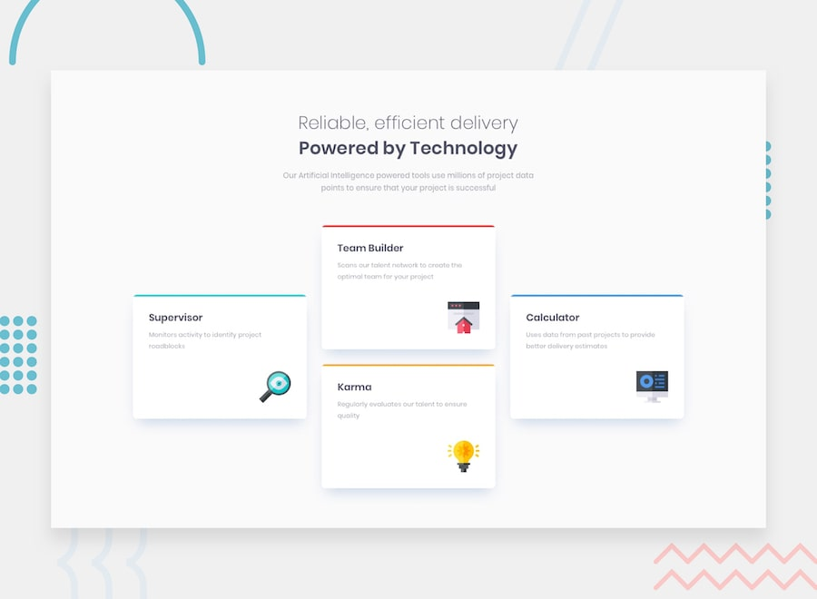

# Four Card Feature Section

My solution to the [Frontend Mentor Four Card Feature Section challenge](https://www.frontendmentor.io/challenges/four-card-feature-section-weK1eFYK).

## Overview

A responsive feature section showcasing four tools: Supervisor, Team Builder, Karma, and Calculator. The mobile layout stacks the cards vertically. On wider screens, the cards form three columns with the two middle cards stacked.

### Links

- **Live site:** [GitHub Pages](https://jeremiah-akpor.github.io/four-card-feature-section-master/)
- **Source code:** [GitHub repository](https://github.com/Jeremiah-Akpor/four-card-feature-section-master)

The live link uses the intended GitHub Pages address and requires GitHub Pages to be enabled for this repository.

## Built with

- Semantic HTML5
- CSS nesting
- Flexbox
- Mobile-first responsive design and media queries
- Google Fonts (Poppins)

## What I learned

- How to share common card styling through a reusable CSS class while giving each card a different colored top border.
- How `box-shadow` creates a soft elevation effect without using borders on every side.
- How to use `display: flex`, `flex-direction: column`, and `align-self: flex-end` to position card icons.
- How to build a desktop layout from three Flexbox groups, using `flex: 1` to distribute the available width and `gap` to space the middle cards.
- Why the viewport width at which a layout becomes cramped should guide the responsive breakpoint.

## Run locally

This is a static HTML and CSS project. Clone the repository and open `index.html` in your browser, or serve the folder with a local web server.

## Author

- [GitHub: Jeremiah-Akpor](https://github.com/Jeremiah-Akpor)

## Credits

Design and challenge by [Frontend Mentor](https://www.frontendmentor.io/).
